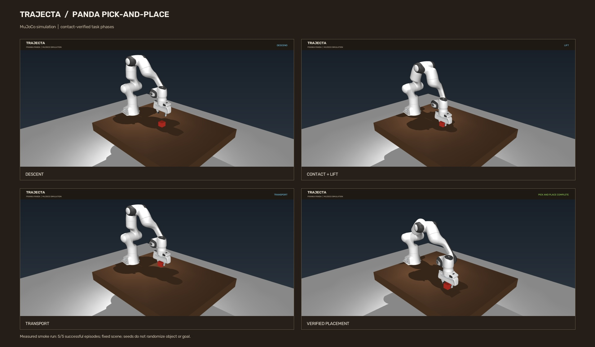
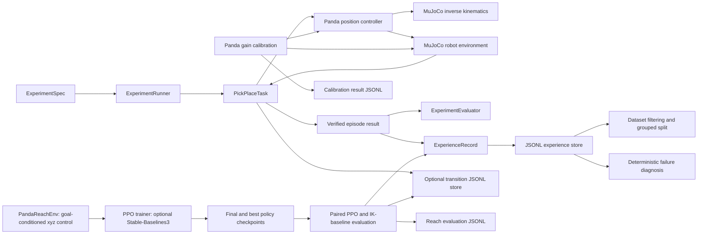

# Trajecta

**A simulation-first robot-learning framework for experiment-driven evaluation, failure analysis, and adaptive control using MuJoCo.**

Trajecta provides reproducible Franka Emika Panda tasks in MuJoCo. The implementation includes a verified pick-and-place experiment pipeline and an optional PPO pipeline for a separate end-effector reaching task. The reach policy is a first narrow learning baseline; it does not train a policy for pick-and-place or a learned dynamics model.



See the [measured smoke-run card](media/trajecta_evaluation_card.jpg), per-episode [JSON summary](media/evaluation_summary.json), and [LinkedIn post draft](media/linkedin_post_draft.md). The 1080p MP4 is generated locally and excluded from Git to keep repository history small.

## Motivation

Robotics experiments need clear task outcomes, repeatable configurations, and traceable records. A controller that merely reaches a target does not establish a successful grasp or placement. Trajecta uses MuJoCo for headless simulation and verifies grasp and placement from simulated contacts and object state before reporting success.

## Goals and design principles

- Keep the environment, controller, kinematics, task, experiment orchestration, evaluation, and storage responsibilities distinct.
- Make configuration, action scaling, task completion, and recorded data inspectable.
- Keep simulation as the only robot backend in this release.
- Report measured results with the trial conditions and limits that produced them.
- Add learning and hardware capabilities only with suitable data, tests, baselines, and safety work.

## Current status

| Area | Status |
| --- | --- |
| Experiment specification and controller configuration | Implemented with Pydantic validation |
| Gymnasium-style environment contract | Implemented; action/observation spaces and termination/truncation are explicit |
| MuJoCo Panda scene and model assets | Implemented; bundled upstream assets and license retained |
| Joint/gripper actuation and action mapping | Implemented; normalized action maps by MuJoCo actuator order and control ranges |
| Inverse kinematics and end-effector positioning | Implemented and unit-tested |
| Pick-and-place execution | Implemented with bilateral contact, lift, release, and placement checks |
| Experiment runner and episode evaluation | Implemented; seeded episode sequence and summary metrics |
| Episode experience persistence | Implemented as validated JSONL summaries |
| Step-level transition recording | Implemented as optional versioned JSONL records with validated loading and manifests |
| Failure diagnosis | Initial deterministic evidence-linked rules; hypotheses, not causal conclusions |
| Dataset filtering, manifest, export, grouped split | Implemented for episode summary records |
| Controller calibration | Partially implemented: bounded Panda joint-setpoint gain sweep and paired tracking evaluation; physical dynamics system identification is not implemented |
| Reinforcement learning | Partially implemented: optional PPO training and paired evaluation for Panda reaching; no learned pick-and-place policy |
| Learned dynamics/world model | Not implemented |
| Uncertainty-aware experiment selection | Not implemented |
| Physical robot integration and sim-to-real evaluation | Not implemented |

## Architecture and data flow



See [the architecture notes](docs/architecture.md) for component contracts and data boundaries.

## Technology

- Python 3.10 or newer: package and examples (tested here with Python 3.13).
- MuJoCo 3.x: physics, model loading, contacts, and offscreen rendering.
- Gymnasium: standard action and observation space types and environment conventions.
- Stable-Baselines3 (optional `rl` extra): PPO implementation for Panda reaching; PyTorch is installed as its dependency.
- NumPy: numerical state and IK calculations.
- Pydantic 2: validated experiment and experience schemas.
- pytest: automated tests.
- OpenCV (optional `video` extra): MP4 recording and phase-frame export.

The install distribution is named `trajecta`; the source import namespace remains `roboforge` for compatibility with the existing code and tests. No hardware libraries are used.

## Repository layout

```text
src/roboforge/controllers/       controllers and controller contracts
src/roboforge/environments/      MuJoCo/Gymnasium boundary, IK, bundled Panda model
src/roboforge/tasks/             pick-and-place state machine and verification
src/roboforge/experiments/       specifications, runner, evaluation, records, datasets
src/roboforge/visualization/     optional MuJoCo viewer
examples/                        demos, evaluation, failure analysis, video capture
tests/                            unit and simulation integration tests
docs/                             architecture and contributor guides
media/frames/                    selected simulation frames for project presentation
```

## Setup

Use a clean virtual environment from the repository root:

```bash
python3 -m venv .venv
source .venv/bin/activate
python -m pip install -e '.[dev,video]'
```

MuJoCo's Franka Panda model and meshes are bundled in `src/roboforge/environments/assets/panda/`; no separate model download is needed. The bundled `venv/` in some copies is machine-specific; create `.venv` as above if it points to a missing interpreter.

## Run the simulation and experiments

Open the model viewer:

```bash
python -m roboforge.visualization
```

On macOS, run the interactive pick-and-place demo through MuJoCo's launcher:

```bash
mjpython examples/pick_place_panda.py --seed 0
```

Run a headless batch and persist episode summaries:

```bash
python examples/evaluate_pick_place.py --episodes 5 --seed 0 --output artifacts/experiences.jsonl
```

To also record every environment step, pass a separate transition output path:

```bash
python examples/evaluate_pick_place.py --episodes 1 --seed 0 --output artifacts/experiences.jsonl --transitions artifacts/transitions.jsonl
```

This writes episode summaries and step transitions separately. The transition dataset is validated after the run and a matching `artifacts/transitions.manifest.json` is written. Load it with `TransitionDataset.from_jsonl("artifacts/transitions.jsonl")` from `roboforge.experiments`. Transitions preserve the environment reward (currently `0.0` in the MuJoCo adapter); task success and phase are separate fields and are not presented as a learned or shaped reward.

Analyze failures in a saved JSONL file:

```bash
python examples/analyze_experiences.py artifacts/experiences.jsonl
```

Record a 1080p, 50 FPS MP4 and task-phase stills:

```bash
python examples/record_pick_place.py --seed 0 --output media/trajecta_pick_and_place_1080p.mp4 --frames-dir media/frames --width 1920 --height 1080 --fps 50
```

Run a reproducible controller-gain calibration sweep:

```bash
python examples/calibrate_panda_controller.py --episodes 3 --seed 0 --candidate-kp 0.25 0.5 0.75 1.0
```

This compares the existing direct-target baseline with bounded candidate gains under the same reset seeds and joint-target offsets. It saves validated calibration results and step transitions under `artifacts/`; acceptance requires at least two paired episodes plus the configured RMSE improvement, settling, and constraint checks. Acceptance never changes the controller default automatically. See [controller calibration](docs/calibration.md) for the objective, metrics, and limits.

Train and evaluate the optional PPO policy for Panda reaching (the `rl` extra installs Stable-Baselines3 and PyTorch):

```bash
python -m pip install -e '.[dev,rl]'
python examples/train_panda_reach.py --total-timesteps 50000 --seed 0
python examples/evaluate_panda_reach.py artifacts/panda_reach_ppo/checkpoints/best_model.zip --episodes 20 --seed 1000000
```

See [Panda reach PPO](docs/reinforcement_learning.md) for reward details, outputs, comparison methodology, and limitations.

Run tests:

```bash
python -m pytest -q
```

More examples and the exact stored fields are documented in [experiments](docs/experiments.md). The optional GUI viewer was not part of headless test verification.

## Evaluation data

The checked-in local run record set contains five successful episodes at seeds 0 through 4. Every record reports 570 control steps and 0.007594639 m horizontal placement error. The current environment resets the object to the same fixed location; these seeds do not yet randomize object or goal placement. Treat this as a deterministic smoke run, not evidence of generalization or a statistically meaningful benchmark. Episode summary JSONL omits per-step observations/actions/rewards; optional transition JSONL captures those separately.

The video renderer reports the actual outcome and measured placement error. Screenshots in `media/frames/` are captures from the same simulator, not external photos.

## Limitations and roadmap

Current task/controller assumptions are specific to the bundled Panda scene. PPO trains only a goal-conditioned reaching policy and reports paired held-out-seed results against the IK-guided heuristic; it does not train pick-and-place or establish generalization. The pick-and-place adapter's optional step records still carry that environment's zero reward; the reach environment has a separate shaped reward. Calibration currently tunes the controller's setpoint blend gain; identifying physical dynamics such as mass, friction, or actuator response remains future work. Learned world models, uncertainty-aware experiment selection, domain randomization, alternative robot backends, and hardware/sim-to-real evaluation remain future work.

Roadmap: (1) expand randomized held-out task evaluation; (2) identify measurable MuJoCo actuator/robot dynamics beyond command gain; (3) train/evaluate a policy and a narrowly scoped learned dynamics baseline; (4) measure candidate selection against a random baseline; (5) define and validate any hardware boundary independently. Transition capture is a data-recording facility only; it does not implement reinforcement learning, a learned world model, or adaptive experiment selection.

## Contribution, license, and attribution

See [CONTRIBUTING.md](CONTRIBUTING.md) and the development guide. Original project code is licensed under the root MIT license. The bundled MuJoCo Menagerie Panda model is separately licensed under Apache-2.0; retain its included license and attribution. See [third-party notices](THIRD_PARTY_NOTICES.md). These licenses do not imply affiliation with Franka, DeepMind, or MIT.

## Troubleshooting

- **`ModuleNotFoundError`:** activate `.venv` and run `python -m pip install -e '.[dev,video]'`.
- **Viewer fails to start:** graphical support depends on the local display and MuJoCo platform setup. Headless tests and video rendering do not require opening the interactive viewer.
- **macOS passive viewer error:** launch the demo with `mjpython examples/pick_place_panda.py --seed 0`.
- **Video codec unavailable:** install the optional extra; the recorder reports an error if OpenCV cannot open an MP4 writer.
- **Model file missing:** verify `src/roboforge/environments/assets/panda/panda.xml` and the adjacent `assets/` directory are present.
