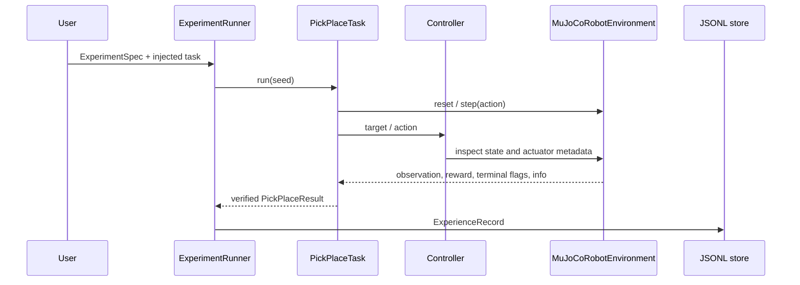

# Architecture

Trajecta is a single Python package with explicit interfaces between experiment orchestration, task logic, robot control, and simulation. The source import package remains `roboforge` for backwards compatibility; the published Python distribution is `trajecta`.

## Components

- **Experiment configuration** (`experiments/spec.py`): immutable Pydantic models validate task, episode count, seed, and controller settings.
- **Environment boundary** (`environments/contract.py`): Gymnasium-like reset, step, spaces, and close behavior.
- **MuJoCo adapter** (`environments/mujoco_env.py`): loads the packaged Panda model, maps normalized actions in actuator order to each actuator's control range, and exposes state metadata.
- **Controller and kinematics** (`controllers/`, `environments/mujoco_ik.py`): end-effector target solving and joint-position feedback. The controller receives the environment; it does not create it internally.
- **Task** (`tasks/pick_place.py`): phase state machine for approach, bilateral contact, lift, transport, release, and placement verification. It does not teleport the object.
- **Runner and evaluation** (`experiments/runner.py`, `evaluation.py`): derive per-episode seeds from the spec, invoke a task, create episode records, and aggregate explicit task outcomes.
- **Experience** (`experiments/experience.py`, `dataset.py`): validate schema-versioned episode summaries, append JSONL, filter records, manifest datasets, and split records by experiment ID.
- **Failure analysis** (`experiments/failure_analysis.py`): deterministic string/phase rules yield a category, observed evidence, a qualified hypothesis, and a next investigation.
- **Controller calibration** (`experiments/calibration.py`): paired seeded Panda joint-target trials compare the default direct setpoint against bounded blend gains, estimate the commanded blend from normalized actions, and persist tracking evidence without changing controller defaults.
- **Visualization and examples** (`visualization/`, `examples/`): optional viewer, task/evaluation examples, and headless video capture.

## Data flow

## Boundaries and limitations

Episode summaries describe episodes; optional transition records contain per-step data. No RL learner or learned dynamics implementation consumes them. Failure categories are not causal claims. The environment is simulation-only; there is no physical robot interface or safety controller. The task currently uses the fixed cube and destination in the bundled scene, so task seeds do not provide domain randomization. Calibration estimates the controller setpoint blend only; it does not identify physical robot or actuator dynamics.
