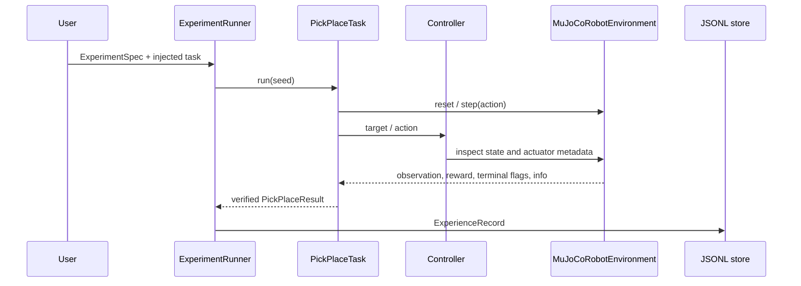
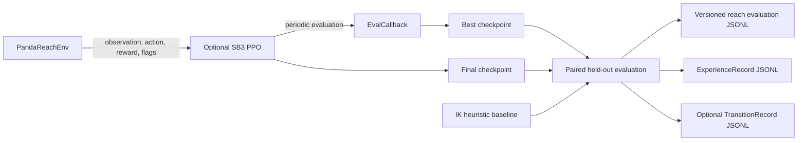
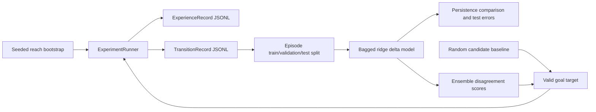

# Architecture

Trajecta is a single Python package with explicit interfaces between experiment orchestration, task logic, robot control, and simulation. The source import package remains `roboforge` for backwards compatibility; the published Python distribution is `trajecta`.

## Components

- **Experiment configuration** (`experiments/spec.py`): immutable Pydantic models validate task, episode count, seed, and controller settings.
- **Environment boundary** (`environments/contract.py`): Gymnasium-like reset, step, spaces, and close behavior.
- **MuJoCo adapter** (`environments/mujoco_env.py`): loads the packaged Panda model, maps normalized actions in actuator order to each actuator's control range, and exposes state metadata.
- **Robot backend boundary** (`environments/robot_backend.py`): exposes capabilities and validated state/joint/gripper/reset commands through `RobotBackend`; the only implementation is MuJoCo. Factory creation of physical backends is disabled and raises an explicit error.
- **Controller and kinematics** (`controllers/`, `environments/mujoco_ik.py`): end-effector target solving and joint-position feedback. The controller receives the environment; it does not create it internally.
- **Task** (`tasks/pick_place.py`): phase state machine for approach, bilateral contact, lift, transport, release, and placement verification. It can sample bounded seeded initial/target/physics conditions, replan a limited number of times after detected cube motion, and retry classified failures within an explicit retry budget.
- **Runner and evaluation** (`experiments/runner.py`, `evaluation.py`): derive per-episode seeds from the spec, invoke a task, create episode records, and aggregate explicit task outcomes.
- **Experience** (`experiments/experience.py`, `dataset.py`): validate schema-versioned episode summaries, append JSONL, filter records, manifest datasets, and split records by experiment ID.
- **Failure analysis** (`experiments/failure_analysis.py`): deterministic string/phase rules yield a category, observed evidence, a qualified hypothesis, and a next investigation.
- **Controller calibration** (`experiments/calibration.py`): paired seeded Panda joint-target trials compare the default direct setpoint against bounded blend gains, estimate the commanded blend from normalized actions, and persist tracking evidence without changing controller defaults.
- **Panda reach environment** (`environments/panda_reach.py`): separate Gymnasium goal-reaching task with bounded Cartesian-delta actions, joint/goal observations, explicit shaped reward, workspace/IK constraint termination, and an IK-guided baseline.
- **Optional PPO pipeline** (`experiments/rl.py`): Stable-Baselines3 PPO training, periodic evaluation and checkpointing, plus held-out paired evaluation against the IK baseline. Evaluation can persist existing episode experiences and step transitions as well as versioned policy metrics.
- **Predictive learning and selection** (`experiments/world_model.py`, `active_learning.py`): episode-split NumPy ridge ensemble trained from Panda reach transition records; it excludes the fixed-base free-joint pose and predicts 24 named joint/task state deltas. It provides persistence comparison, held-out prediction/disagreement metrics, seeded bounded target candidates, random or uncertainty ranking, runner-based execution, and retraining.
- **Visualization and examples** (`visualization/`, `examples/`): optional viewer, task/evaluation examples, and headless video capture.

## Data flow

The separate reaching/training flow is:

The predictive-learning loop reuses the existing experience and transition stores, plus `ExperimentRunner` for each selected reach episode:

## Boundaries and limitations

Episode summaries describe episodes; optional transition records contain per-step data. The PPO reach pipeline is the only RL implementation and trains on the separate reaching task; it does not consume the existing pick-and-place experiment records for learning. A NumPy ridge ensemble predicts Panda reach observation deltas only; it is not a contact-rich manipulation dynamics model. Its ensemble disagreement ranks bounded reach targets, but is not calibrated confidence. Failure categories are not causal claims. The environments are simulation-only; there is no physical robot interface or safety controller. Pick-and-place can vary bounded cube/target/joint/physics reset conditions, but has no calibrated domain distributions or physical safety guarantee. The manipulation task remains directly coupled to MuJoCo state/controller interfaces despite the new backend boundary. Calibration estimates the controller setpoint blend only; it does not identify physical robot or actuator dynamics. No physical robot adapter exists, and no sim-to-real evaluation has been run.
